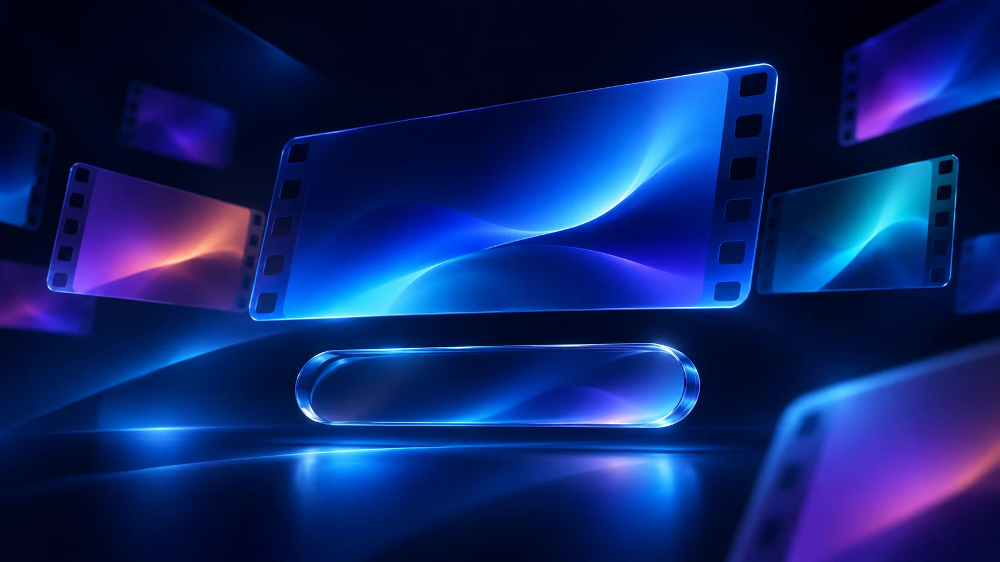

# brrPlayer

  

<strong>Your films. Your space.</strong> A private, local-first Android movie and television library with an integrated player.

  
  
  

The banner is original generated concept art, not an app screenshot. It is a visual direction, not a claim that every illustrated finish is already implemented.

## A considered home for your collection

brrPlayer turns one folder you select into a searchable movie and TV library. Titles, posters and playback stay attached to the files you already have. Browse offline, then play a local video without sending it to a server.

- **One folder, by choice.** Android’s Storage Access Framework gives read-only access to the selected folder and its descendants. There is no all-files permission.
- **A library that works offline.** Local video names, episode details and the indexed catalogue are stored on device. Optional metadata can enrich the presentation without becoming a requirement for browsing or playback.
- **A player built into the library.** Media3 plays local documents, offers audio and subtitle track selection, and keeps sidecar captions independent from video zoom.
- **A distinct glass direction.** The intended interface pairs cinematic media shelves with restrained, interactive Liquid Glass controls. The music app is consulted only for its glass engine and dock-collapse motion; its music interface is not being reused.

## Privacy is part of the design

- Video and subtitle files are never uploaded, changed, moved or deleted.
- The library reads only inside the single folder you selected.
- App backup is disabled; there is no account, cloud library, advertising, telemetry or media server.
- Optional TMDB requests are limited to normalized media identifiers such as title, year and type. The app’s opt-in and request policy remain explicit; a public app credential is not a secret, and TMDB necessarily receives network metadata such as the request IP.
- Local library and playback remain useful without metadata access or a network connection.

See [storage and privacy rules](docs/UPSTREAM_AND_PRIVACY.md) and [architecture](docs/ARCHITECTURE.md).

## Identity migration and release status

The requested identity is **brrPlayer**, package `com.mangoloads.player`. The older signed Player app used `com.batmancpu.player`; Android treats these as separate apps. A brrPlayer release therefore installs alongside the legacy app and cannot automatically inherit its saved folder grant or library database. The existing release signing certificate is preserved.

The latest published APK belongs to the legacy package: [Player v0.1.250](https://github.com/Batmancpu/Player/releases/tag/v0.1.250). The brrPlayer identity and visual assets are in development; this README does not imply that the new signed package has already been released. New signed APKs will be published once a substantial batch passes automated privacy, identity and signing checks.

The user reported that v0.1.79 found four local videos, displayed their names and years, retained the library after an airplane-mode restart and switched folders correctly. Later catalogue, Media3 playback and caption work has emulator/CI coverage; it still needs real-device checks on the OPPO Reno10 5G. No FPS, heat or battery target is claimed without measurements on that handset.

## Project checkpoints

Work is grouped into substantial checkpoints rather than producing an APK for each small fix:

1. **Identity foundation** — brrPlayer name and package migration, original launcher mark, concept-art README and corrected installation expectations.
2. **Library and playback** — remaining folder recovery, scan cancellation and bounds, local playback, captions and persistence edge cases.
3. **Glass and catalogue experience** — use only the inspected music app’s licensed Glass engine and collapse motion; adapt them to an original film and series interface with accessible opaque/reduced-motion fallbacks.
4. **Release readiness** — regression coverage, licensing/privacy audit, one signed APK at the completed batch boundary, followed by the user’s phone checklist.
5. **Measured polish** — release-like frame timing, memory, thermal and battery investigation on the actual Reno10; tune only from recorded evidence.

Implementation continues between checkpoints. A phone acceptance report is still needed for final phase acceptance, and it will not be invented from emulator results.

## Project records

- [Current handoff](docs/WORK_HANDOFF.md)
- [Product roadmap](docs/ROADMAP.md)
- [Architecture](docs/ARCHITECTURE.md)
- [Design and device-performance requirements](docs/DESIGN_SYSTEM_AND_PERFORMANCE.md)
- [Storage, network and privacy rules](docs/UPSTREAM_AND_PRIVACY.md)
- [Glass engine review](docs/GLASS_ENGINE_REVIEW.md)
- [Phone-test checklist](docs/PHASE1_PHONE_TEST.md)
- [Development log](DEVELOPMENT_LOG.md)
- [Known issues and fixes](ISSUES_AND_FIXES.md)
- [Third-party notices](THIRD_PARTY_NOTICES.md)
- [AI-agent operating rules](AGENTS.md)

## Design references

- [Apple Human Interface Guidelines — Materials](https://developer.apple.com/design/human-interface-guidelines/materials)
- [Haze Glass documentation](https://chrisbanes.github.io/haze/2.1.0/)
- [brrMusic](https://github.com/Batmancpu/brrMusic) — Glass engine and dock interaction research only, subject to its license and attribution.
- [brrrBoard](https://github.com/Batmancpu/brrrBoard) — icon-design inspiration only; no keyboard UI, artwork or code is included.
- [TMDB API documentation](https://developer.themoviedb.org/docs/getting-started)

The launcher mark and banner are original generated assets. No Apple logo, SF Symbols artwork, Apple font or recognizable film poster is bundled.
