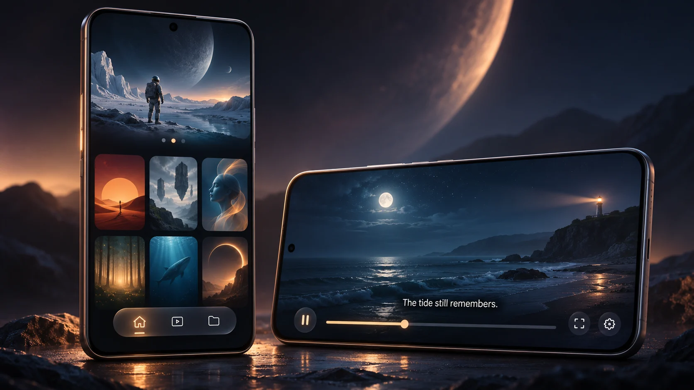
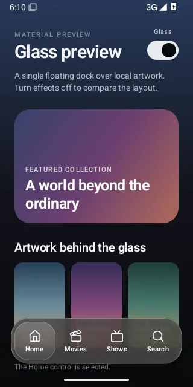

# Player

  <strong>Your library, on your terms.</strong> 
  A private, local-first Android library and player for the films and shows you already own.

  
  
  

  

Original concept artwork for Player. It illustrates the visual direction and is not an in-app screenshot or a claim that every shown detail is implemented.

## What Player is

Player turns **one folder you choose** into a searchable movie and TV library, then plays those files locally. Its goal is a calm, cinematic catalogue with restrained glass controls, while keeping your media and library data on your device.

- **One selected folder.** Android’s Storage Access Framework grants read access to that folder and its descendants. Player does not request all-files access.
- **Offline library.** Filenames are organized into movies and episodes; the indexed library and confirmed details are stored locally so the collection remains useful offline.
- **Local playback.** Media3 plays the selected document directly. Device and codec support determines which formats can play. Sidecar subtitles are kept separate from the zoomable video frame.
- **Optional online metadata.** TMDB matching is user-controlled and manual. When enabled, a search sends only a normalized title, year and media type; no path, folder listing, SAF URI, video or subtitle content is sent.

  
  &nbsp;&nbsp;
  

Android 15 CI captures using synthetic test data. The Glass Lab is an experiment, not the finished library design; these images do not represent OPPO handset performance.

## Privacy by design

- Your video and subtitle files are never uploaded, renamed, moved, edited or deleted by Player.
- Access stays within the single folder tree you selected and is read-only.
- No Player account, media server, cloud library, ads, analytics or telemetry.
- App backup is disabled.
- Optional metadata and artwork use approved TMDB destinations only after you enable metadata features; the local library remains available without a connection.

See [storage and privacy rules](docs/UPSTREAM_AND_PRIVACY.md) and [architecture](docs/ARCHITECTURE.md).

## Current development status

The latest signed build is listed on the [Releases page](https://github.com/Batmancpu/Player/releases/latest). Existing signed installs keep the same package and permanent update certificate. These are development checkpoints; the integrated premium app is still in progress.

The user confirmed that v0.1.79 selected a folder, identified four local videos with titles and years, retained the library after an airplane-mode restart, and handled folder switching. Since then, main has gained title shelves, series season grouping, local Media3 playback, validated same-folder sidecar subtitles and a custom Compose transport. Android 15 CI #221 and #226 passed 52 and 53 instrumentation tests respectively, with unit/build/schema/privacy gates green. CI #223 confirmed selected local SRT cues reach Media3 and the Glass Lab dock-clear test passes. Commit `1c19a08` adds accessible player control restoration and compact header icons; `b44990c` fixes its test helper. Commit `91aabf2` adds a Compose audio/subtitle sheet. CI #236 compiled the Home hero and picker changes and ran 53 Android tests (51 passed); the direct subtitle-off engine assertion and Movies poster layout passed. Two test issues remain under correction: selected radio state lookup and modal-entry timing for the Glass preference. A Home hero feature has been added in source, with cached artwork only and local Play/Details actions. Emulator evidence is not Reno10 performance or acceptance. The latest signed progress checkpoint remains [Player v0.1.174](https://github.com/Batmancpu/Player/releases/tag/v0.1.174), versionCode 174. The user wants one integrated APK after remaining features and final efficiency review.

**Glass is still being refined.** Haze 2.1.0 powers both the bounded production library navigation dock and a separate visual lab. The Android treatment is original and does not reproduce Apple's proprietary renderer. The lab is an experiment, not a promise of device-level blur or the final tactile finish. See the [engine review](docs/GLASS_ENGINE_REVIEW.md).

## Work plan

The integrated app is being completed in four visible batches. Development continues between checkpoints; there is no phone-install pause after each batch.

1. **README and visual identity** — original concept artwork and honest project overview. This batch is complete.
2. **Library and playback completeness** — folder recovery and scan edge cases, playback controls, subtitle workflows and persistent offline behavior.
3. **Production experience** — coherent movie/show navigation, polished title details, accessible controls, original restrained Glass and non-Glass fallbacks.
4. **Release readiness** — automated regression coverage, licensing/privacy review, signed update build, and release checklist. Measure frame time, memory and thermal behavior on the Reno10 when physical device data is available; do not infer those results from CI.

Follow the [six-phase roadmap](docs/ROADMAP.md) for engineering detail. A signed APK will be published to GitHub Releases for Obtainium after the requested build passes the release workflow's test, privacy and permanent-certificate checks. Use only a signed Release APK for installation; CI debug APKs are not for updating the installed app.

## Project records

- [Current handoff](docs/WORK_HANDOFF.md)
- [Product roadmap](docs/ROADMAP.md)
- [Architecture](docs/ARCHITECTURE.md)
- [Design and device-performance requirements](docs/DESIGN_SYSTEM_AND_PERFORMANCE.md)
- [Storage, network and privacy rules](docs/UPSTREAM_AND_PRIVACY.md)
- [Glass engine review](docs/GLASS_ENGINE_REVIEW.md)
- [Phone-test checklist](docs/PHASE1_PHONE_TEST.md)
- [Development log](DEVELOPMENT_LOG.md)
- [Known issues and fixes](ISSUES_AND_FIXES.md)
- [Third-party notices](THIRD_PARTY_NOTICES.md)
- [AI-agent operating rules](AGENTS.md)

## Design references

- [Apple Human Interface Guidelines — Materials](https://developer.apple.com/design/human-interface-guidelines/materials)
- [Haze Glass documentation](https://chrisbanes.github.io/haze/2.1.0/)
- [TMDB API documentation](https://developer.themoviedb.org/docs/getting-started)

Player uses original Android code and generated concept artwork. It does not include Apple fonts, symbols, logos or proprietary assets.

**Glass Lab note:** The current lab previews a bounded selection dock over generated artwork and has a visible return to the library. Its tabs do not navigate the catalogue. The real library's separate dock is functional and has an effects-off fallback. Further visual tuning and Reno10 profiling remain in progress.
